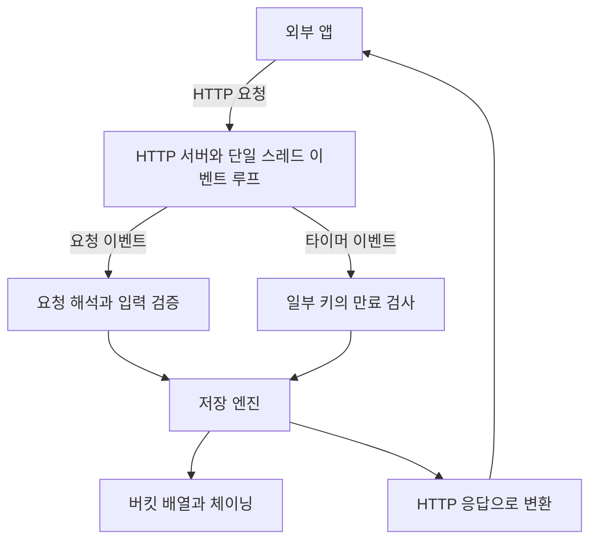

# Mini Redis의 내부 구조와 동작

이 문서는 구현 전 합의한 주요 구조와 앞으로 정의할 계약을 구분합니다. 설계 선택의 이득과 비용은 [DECISIONS.md](DECISIONS.md), 개념 설명은 [학습 목차](../study/00-overview.md)를 참고합니다.

## 목적과 경계

여러 외부 프로그램이 문자열 키·값을 저장·조회·삭제하고 유효기간을 설정할 수 있는 독립적인 메모리 서버를 만듭니다. 직접 만든 해시 테이블을 HTTP 인터페이스로 노출합니다.

문자열 외 자료형, RESP 클라이언트 호환, 영속성, HTTP/2 프록시는 초기 필수 범위에 넣지 않습니다. 원본 API 조회와 응답 캐싱의 활용 로직은 별도 데모 앱에서 수행하는 구성을 검토합니다.

## 목표 처리 흐름

요청 콜백과 만료 콜백이 저장소를 같은 스레드에서 처리해야 합니다. 타이머는 요청이 들어와야 실행되는 후속 작업이 아니라 이벤트 루프에 별도로 등록할 이벤트입니다. 실제 라이브러리의 스레드 모델과 타이머 통합은 미검증입니다.

## 저장 엔진

- 키의 바이트열에 FNV-1a 64비트를 적용하고 `해시값 % 버킷 수`로 위치를 찾습니다.
- 같은 버킷에서는 연결 리스트를 순회하며 실제 키를 비교합니다.
- 키가 같으면 덮어쓰고, 다른 키이면 충돌한 별도 항목으로 보관합니다.
- 버킷 16개로 시작해 신규 키로 적재율이 0.75를 초과하면 2배 확장합니다.
- 12개 키는 유지하고 13번째 신규 키에서 32개 버킷으로 확장합니다. 덮어쓰기는 키 수를 늘리지 않습니다.
- 초기 리해싱은 한 번에 재배치합니다. 큰 확장 중 다른 요청의 지연을 측정해야 합니다.

평균 O(1) 탐색은 적절한 분산과 적재율을 가정합니다. 문자열 길이에 따른 계산·비교·복사 비용과 충돌이 몰리는 경우를 별도로 고려합니다.

## 값의 수명

일반 저장은 값을 교체하고 기존 TTL을 제거합니다. TTL 포함 저장은 새로운 만료 시각을 설정합니다. 현재 시각이 만료 시각 이상이면 값을 반환하지 않습니다.

접근 시 만료를 확인하고 삭제하는 수동적 만료와, 접근 없는 키도 회수하는 능동적 만료를 함께 사용합니다. 초기 능동 검사 정책은 100ms마다 최대 100개 키를 버킷 순서로 검사하는 것입니다. 이 수치는 모든 키의 100ms 이내 삭제를 보장하지 않습니다.

검사 위치를 유지하는 구체적인 방법은 미정입니다. 삭제·삽입·리해싱 후 잘못된 노드 주소를 사용하지 않으며 검사 진행이 멈추지 않도록 해야 합니다. 키 수 제한과 빈 버킷 순회 비용도 구분해야 합니다.

## 반드시 지켜야 할 조건

| 조건 | 의미 |
| --- | --- |
| 실제 키로 구분 | 버킷 번호가 같다는 이유로 다른 키를 덮어쓰지 않음 |
| 만료된 값 반환 금지 | 주기적 회수가 늦어도 접근 시 만료 검사 |
| 삭제 후 연결 보존 | 충돌 목록의 다른 항목이 계속 조회됨 |
| 확장 후 내용 보존 | 키·값이 누락되거나 중복되지 않음 |
| 소유권과 실패 계약 명시 | 교체·확장 실패 후 상태와 반환값을 결정하고 검증 |
| 한 스레드가 저장소 소유 | 요청과 만료 작업의 저장소 접근이 같은 스레드에서 수행됨 |

한 요청을 순차 처리하는 구조가 여러 요청의 트랜잭션까지 보장하지는 않습니다. 서로 다른 앱이 모두 0을 읽고 1을 저장하면 두 번의 증가 의도와 달리 최종 값은 1일 수 있습니다. 이번 필수 범위에 증가 명령이나 트랜잭션을 임의로 추가하지 않습니다.

## 다음 구현 단위에서 정할 계약

1. 키·값 표현, 복사 여부와 메모리 소유권, 조회 결과 수명
2. 빈 키·빈 값·최대 길이·인코딩·NUL 처리
3. 오류 반환값, 할당 실패, 확장 한계와 기존 데이터 보존
4. TTL 단위·시간원·범위와 검사 위치 정책
5. HTTP 라이브러리·버전 번호·경로·본문·응답·자원 제한

HTTP API 사용은 확정됐고 특정 버전 번호와 라이브러리는 미정입니다. `PUT /keys/{key}` 등 기존 예시는 제안 상태입니다. 위 계약은 기능별 테스트의 입력·기대 결과를 함께 정하면서 확정합니다.

[문서 안내](README.md) · [설계 선택과 대안](DECISIONS.md) · [검증 계획](../study/08-verification.md)
